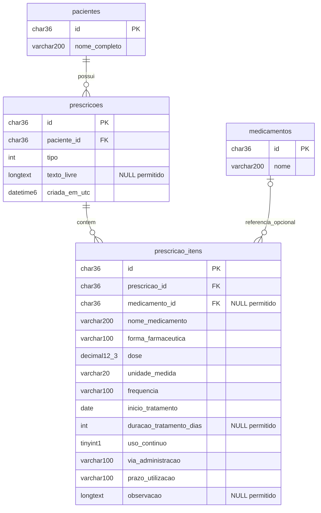

# Diagrama Entidade-Relacionamento — MedicalPrescription

Modelagem obtida a partir de `database/schema.sql` e da migration `20261117042749_CriacaoInicial` na branch `develop` do repositório `rafaelrocha011/medical-prescription` (17/11/2026).

## Relacionamentos

| Relacionamento | Cardinalidade | Integridade referencial |
|---|---|---|
| `pacientes` → `prescricoes` | Um paciente pode ter zero ou várias prescrições; cada prescrição pertence a um paciente | `ON DELETE RESTRICT` |
| `prescricoes` → `prescricao_itens` | Uma prescrição pode ter zero ou vários itens no banco; cada item pertence a uma prescrição | `ON DELETE CASCADE` |
| `medicamentos` → `prescricao_itens` | Um item pode referenciar zero ou um medicamento cadastrado; um medicamento pode aparecer em vários itens | `ON DELETE RESTRICT` |

## Regras complementares da aplicação

- `tipo`: **1 = não estruturada**, **2 = estruturada**.
- Prescrição não estruturada exige `texto_livre` e não utiliza itens; prescrição estruturada exige pelo menos um item. Essas invariantes são validadas no Domain, **não pela cardinalidade da chave estrangeira**.
- `medicamento_id` é **opcional** para permitir itens com medicamento não cadastrado, conforme ECF.10.03(c).
- `dose` corresponde a `DECIMAL(12,3)`, com validação de precisão no Value Object `Dosagem`.
- `criada_em_utc` usa `DATETIME(6)`; o modelo .NET deve reconstruir `DateTimeKind.Utc` ao ler os dados.
- A tabela `__EFMigrationsHistory` é metadado técnico do EF Core e, por isso, não aparece no DER de negócio.

## Tipos compactados usados no diagrama

`char36` = `CHAR(36)`; `varchar200` = `VARCHAR(200)`; `varchar100` = `VARCHAR(100)`; `varchar20` = `VARCHAR(20)`; `decimal12_3` = `DECIMAL(12,3)`; `datetime6` = `DATETIME(6)`; `tinyint1` = `TINYINT(1)`.

**Fonte de verdade do esquema:** `database/schema.sql`. Para instalações novas, verificar que o script SQL e as migrations continuam alinhados.
